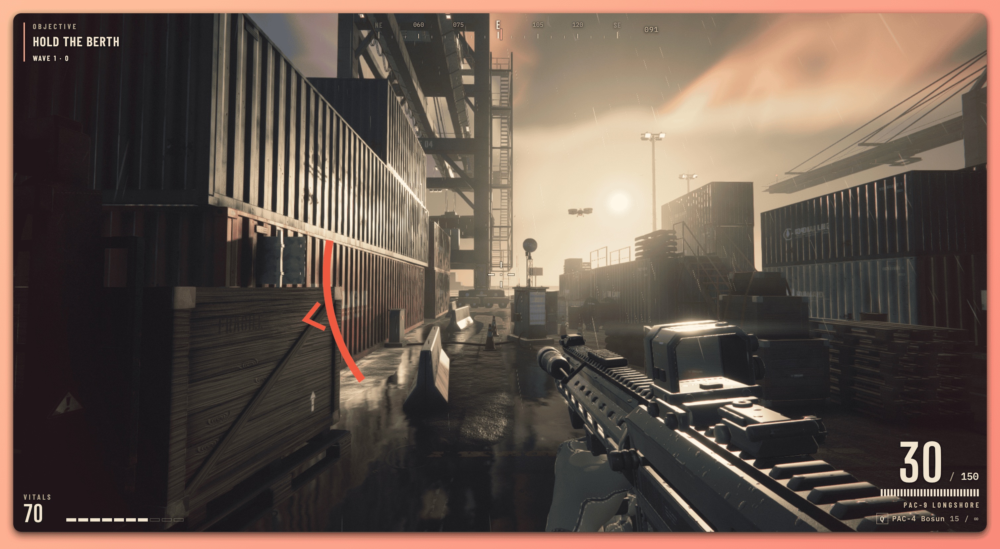
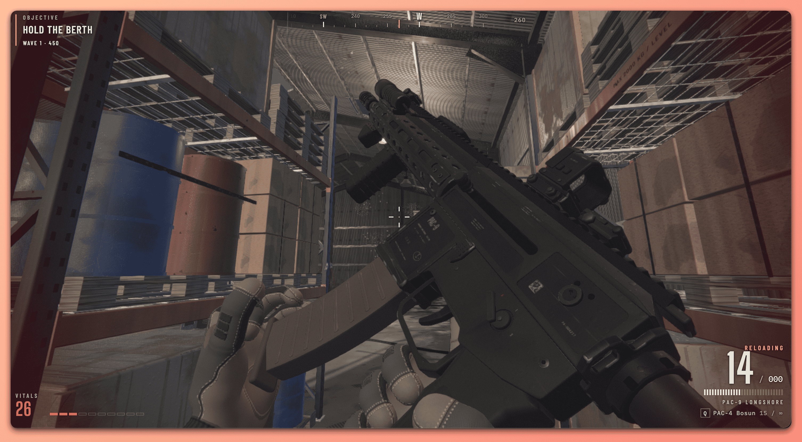
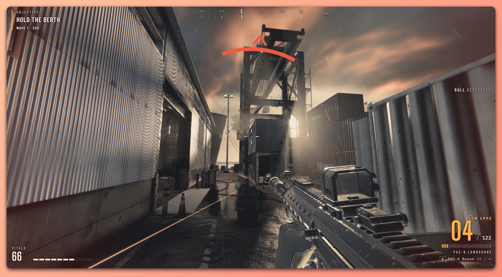

# Saltline

Saltline 是一个浏览器第一人称港区行动游戏。本仓库包含可读源码、单机模式、局域网服务器联机和基于 Trystero 的零服务器 P2P 联机实现。

项目仍处于持续开发阶段，联机协议和美术资源可能变化。欢迎提交 Issue 和 Pull Request。

> **本分支（zh-multiplayer）**：全量中文本地化 + 多人合作/对抗模式（最多 4 人，房主权威架构）。
> 单机玩法完全保留——主菜单「开始行动」即原版单机；「创建房间 / 加入房间」进入联机。

## 联机方式

### 服务器模式

```sh
npm ci
npm run mp
```

浏览器打开 `http://127.0.0.1:8787/`。局域网玩家访问运行服务器设备的 IP 和同一端口即可。

### 零服务器 P2P 模式

P2P 房间使用 Trystero 信令和 WebRTC 连接，不需要运行本项目的 Node 中继服务器，但首次配对仍需要公共信令可达。浏览器必须处于 HTTPS、`localhost` 或其他安全上下文；普通局域网 HTTP 页面不能使用 Web Crypto。

P2P 模式支持房间目录、房间码、合作/对抗模式和最多 4 人。房主掉线时当前版本会结束该局，完整的对局状态迁移尚未实现。

## 多人服务器模式

```sh
npm ci
npm run build
npm run mp          # HTTP 静态 + WebSocket，默认 8787
```

浏览器打开 `http://127.0.0.1:8787/`（局域网队友用本机 IP 同端口）：

1. 房主点「创建房间」，把 4 位房间码发给队友
2. 队友「加入房间」输入房间码
3. 房主在大厅点「开始行动」，全队同 seed 进同一港区

合作模式：三座上行中继全切后全员登船撤离；多人同时切割提速（上限 2 倍）；敌人波次与难度随人数缩放。

对抗模式：房间内自动分队，按当前规则进行团队死斗；结算后返回原房间大厅，房主可以再次开始。

**架构**：房主权威模拟 + Node `ws` 纯中继（server/）；同 seed 各端确定性重建关卡（免几何同步），玩家态 15Hz / 敌人快照 10Hz；设计文档见 `docs/MP-CONTRACT.md` 与 `docs/MP-BLUEPRINT.md`。开发模式 `npm run dev`（5173）已配 `/ws` 代理到 8787，需另起 `npm run mp`。

## 在线试玩（上游单机版）

**[打开 Saltline](https://realskyrin.github.io/fps3ademo-saltline/)**，点击 **DEPLOY** 开始游戏。

## 游戏截图







## 本地开发

需要 Node.js 20.19+ 或 22.12+。推荐使用当前 LTS 和 Chrome/Edge 等支持 WebGL 2 的浏览器。

```sh
git clone <your-repository-url>
cd saltline
npm ci
npm run dev
```

打开 <http://127.0.0.1:5173/>，点击 **DEPLOY** 开始。修改脚本或样式后浏览器会重新加载，当前局会重置。

依赖已经安装时，直接执行 `npm run dev`。游戏、Three.js 和全部字体均在本地，运行期间不需要 Claude、Google Fonts 或其他在线服务，也不需要 API Key。

## 构建和预览

```sh
npm run check
npm run build
npm run preview
```

构建结果在 `dist/`，预览地址是 <http://127.0.0.1:4173/>。`npm run build` 还会生成 `dist-file/index.html` 及其内嵌资源，适合离线分发；完整 P2P 能力仍建议通过 HTTPS 或 `localhost` 运行。

## GitHub Pages 部署

仓库已启用 GitHub Pages，发布来源为 **GitHub Actions**。工作流会执行 `npm ci`、`npm run check` 和 `npm run build`，然后发布 `dist-file/`，因此线上入口是一个自包含的 `index.html`，不需要再上传 `assets/` 或 `node_modules/`。

发布步骤：

1. 把仓库推送到 GitHub 的 `main` 分支。
2. 在 **Settings → Pages → Build and deployment → Source** 选择 **GitHub Actions**。
3. 等待 `Deploy GitHub Pages` 工作流完成，访问 GitHub 显示的 `https://<用户名>.github.io/<仓库名>/` 地址。

纯 HTML 版本适合单机和 HTTPS 下的 P2P 联机。GitHub Pages 本身不运行 Node WebSocket 服务器；需要服务器模式时，另行部署 `server/`，或使用零服务器 P2P。

在其他仓库使用这套工作流时，需要先到 **Settings → Pages → Build and deployment → Source** 选择 **GitHub Actions**，否则部署接口会返回 404。

## 继续修改

| 文件 | 内容 |
| --- | --- |
| `index.html` | 页面入口、画布、启动界面 |
| `src/game.js` | 6 行启动入口，安装道具注册表和错误捕获后启动游戏 |
| `src/app/` | 系统装配、主循环、启动界面、诊断和基准模式 |
| `src/vendor/three-r180.js` | 独立保存的原版 Three.js r180，提供标准命名的导出 |
| `src/core/` | 世界/画质配置、事件、随机数、数学、通用几何和降级实现 |
| `src/render/` | 渲染器、天空、阴影、后处理、材质、纹理和着色器 |
| `src/world/` | 碰撞、道具注册与建模、关卡、远景、地面和水面 |
| `src/input/`、`src/player/`、`src/combat/` | 输入、玩家和战斗判定 |
| `src/weapons/`、`src/enemies/` | 武器/敌人的模型、动画和行为 |
| `src/audio/`、`src/effects/` | 声音合成、音库、混音、粒子和特效 |
| `src/ui/`、`src/game/` | HUD、菜单、设置和任务流程 |
| `src/ui.css` | 原版 HUD、菜单、移动端布局和动效 |
| `src/fonts.css`、`public/fonts/` | 原版三组字体的本地副本 |
| `vite.config.js` | 开发服务器、构建和 source map 配置 |
| `archive/original.html` | 与原站发布清单逐字节校验一致的原始单文件 |
| `archive/manifest.json` | 来源、发布版本、原始大小与 SHA-256 |
| `docs/DEVELOPMENT.md` | 游戏代码定位和诊断入口 |
| `docs/VALIDATION.md` | 本次恢复的验收结果 |
| `docs/REFACTOR_VALIDATION.md` | 模块拆分的代码、场景、截图与操作回归记录 |
| `licenses/` | Three.js 与字体的许可文本 |

## 测试

```sh
npm run check
npm run test:trystero
node scripts/test-pvp10-ui.mjs
npm run build
```

这些命令覆盖源码归档校验、多人 P2P 传输、对抗模式 UI 和生产构建。

## 许可

项目源码按 Apache-2.0 许可证发布，详见根目录 [`LICENSE`](LICENSE)。Three.js 和字体资源保留各自的许可文本，详见 `licenses/`；`archive/` 中的原始发布文件及其来源仍需按对应上游条款使用。

**源码边界：**公开链接只提供一个已打包的 `index.html`，没有发布前的多文件源码、原始变量名或 source map。本地在恢复完整产物后，将它重新组织为 66 个 ES 模块，并为引擎导入、主要工厂函数和上下文参数补充了可读名称。复杂算法内部仍有原版压缩过的局部变量名。模块边界是本地重建的，构建生成的 source map 对应当前本地文件。

## 操作

| 动作 | 按键 |
| --- | --- |
| 移动 / 视角 | WASD / 鼠标 |
| 开火 / 瞄准 | 鼠标左键 / 右键 |
| 换弹 / 近战 | R / F |
| 跳跃 / 冲刺 | Space / Shift |
| 蹲下 | C 或 Ctrl |
| 切断中继 | 在中继附近按住 E |
| 暂停 | Esc 或 P |

浏览器无法锁定鼠标时，原版也支持按住鼠标拖动视角，或方向键 / IJKL 转向、Enter 开火。触屏和手柄支持沿用原版，具体布局在 **CONTROLS** 中查看。

设置保存在当前浏览器的 `localStorage`（`saltline.settings.v1`）。本地地址与原站的浏览器存储相互独立。

## 原件校验

恢复日期：2026-11-10；公开版本：`1794242702-61c7`。

```sh
npm run verify:archive
```

原件大小为 1,429,602 字节，SHA-256：

```text
4a9adc5311188dc488b978c5a72a268419118db3669b921641432ada2fa9a735
```

原件保留原始 Google Fonts 链接；本地开发入口使用已下载的字体。Claude 的页面外壳与注入运行时未加入本地游戏。
